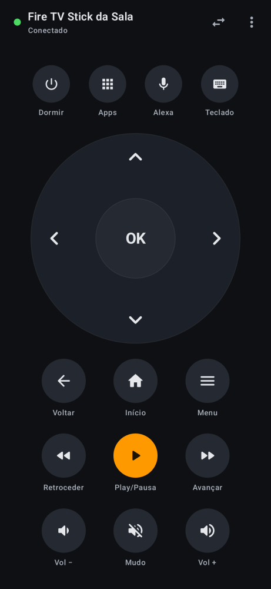
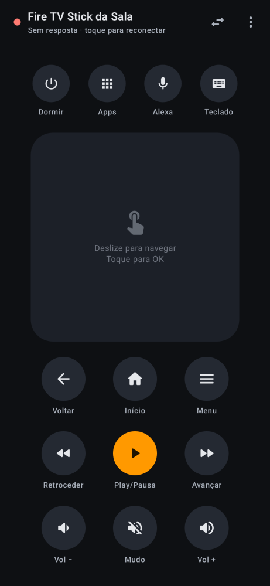
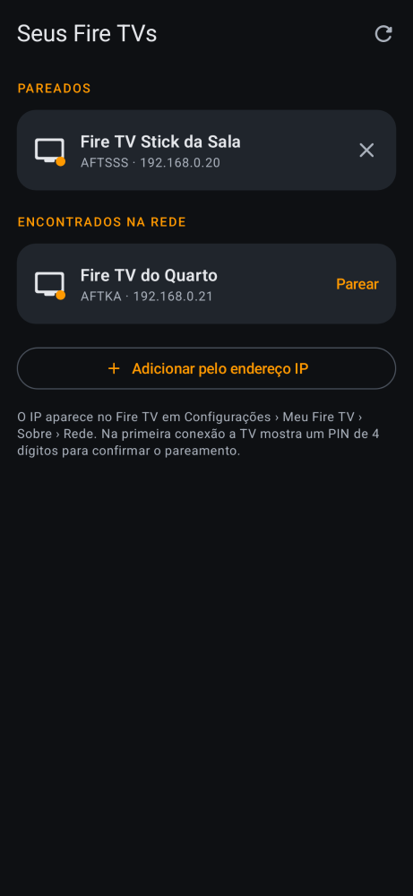
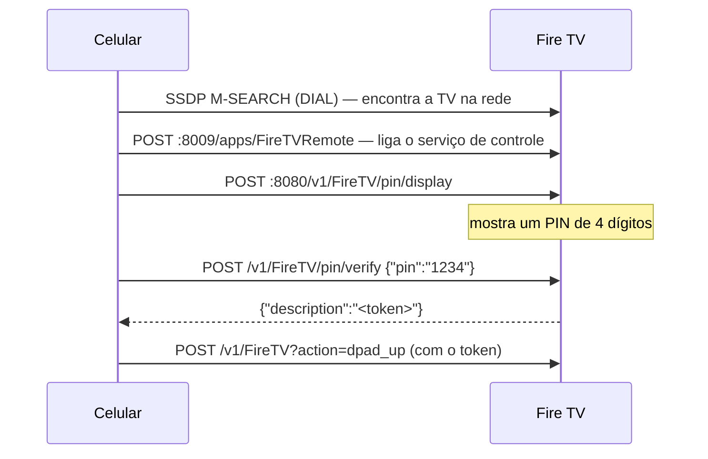

# Controle Fire TV — sem anúncios

App Android para controlar o **Amazon Fire TV / Fire TV Stick** pelo Wi-Fi: sem anúncios, sem
rastreamento, sem conta da Amazon. Usa o mesmo protocolo do app oficial da Amazon, estudado
por engenharia reversa e documentado em [docs/PROTOCOLO.md](docs/PROTOCOLO.md).

<p align="center">
  
  
  
</p>

APK de ~1,4 MB. Um app "Fire TV Remote" com anúncios da Play Store, analisado para este
projeto, tem 42 MB e embute sete SDKs de propaganda e rastreamento — para fazer exatamente as
mesmas chamadas HTTP que este app faz.

## Recursos

- Direcional com OK — segurar rola rápido (a própria TV repete, como no controle físico).
- **Modo touchpad**: deslize para navegar, toque para OK.
- Voltar, Início, Menu, Play/Pausa, retroceder/avançar 10 s (segure para busca contínua).
- Volume e mudo via HDMI-CEC; os **botões de volume do celular** também controlam a TV.
- **Dormir** e liga/desliga da TV (HDMI-CEC).
- **Teclado**: o texto digitado no celular aparece na busca da TV enquanto você digita.
- **Lista de apps** do Fire TV com ícones — toque para abrir.
- **Alexa por voz**: toque no microfone e fale.
- Descoberta automática (SSDP/DIAL), varredura da sub-rede quando o roteador bloqueia
  multicast, ou IP manual. Se o roteador trocar o IP da TV, o app a reencontra.
- Pareamento por PIN de 4 dígitos mostrado na TV — não precisa ativar "Depuração ADB" no Fire TV.
- Confia só na CA da Amazon usada pelo Fire TV (o mesmo certificado fixado pelo app oficial).

Permissões: rede local (Wi-Fi/multicast) e microfone — este só quando você usa a Alexa.

## Como funciona

O Fire TV roda um pequeno servidor HTTPS (porta 8080) que aceita comandos de apps pareados:



Detalhes — teclas, mídia, teclado, apps, voz, certificado e as diferenças em relação ao que
as bibliotecas abertas documentam — em [docs/PROTOCOLO.md](docs/PROTOCOLO.md). A referência
técnica completa extraída do app oficial está em [docs/spec-app-oficial.md](docs/spec-app-oficial.md).

## Instalar

Baixe o `ControleFireTV.apk` em [Releases](https://github.com/Edx0n/firetv-remote-control-adfree/releases)
ou compile (abaixo).

Em países onde o Android exige desenvolvedor verificado para instalar APKs de fora da Play
Store (o Brasil, desde 30/09/2026), instale **via ADB** — que é isento — ou use o fluxo avançado
das Opções do desenvolvedor (reinício + espera de 24 h, uma vez). Via ADB por Wi-Fi:

1. No celular: *Sobre o telefone* › toque 7× em *Número da versão*; em *Opções do
   desenvolvedor*, ative **Depuração por Wi-Fi** › *Parear dispositivo com código*.
2. No PC, na mesma rede:

```
adb pair IP_DO_CELULAR:PORTA_DE_PAREAMENTO
adb connect IP_DO_CELULAR:PORTA_DA_DEPURACAO
adb install -r ControleFireTV.apk
```

Dica: `adb mdns services` mostra os endereços e portas do celular sem precisar digitá-los.

## Primeiro uso

1. Celular e Fire TV no mesmo Wi-Fi, TV ligada.
2. Abra o app: o Fire TV aparece em "Encontrados na rede" (ou use *Adicionar pelo endereço IP*;
   o IP fica em *Configurações › Meu Fire TV › Sobre › Rede*).
3. Toque em **Parear** e digite o PIN que aparece na TV.

Para revogar o acesso de apps-controle antigos (os com anúncios, por exemplo):
`python tools/firetv.py raw POST /v1/FireTV/clearTokens` — isso despareia todos; depois pareie este de novo.

## Compilar

Requisitos: JDK 17 e Android SDK (platform 35, build-tools 35).

```
gradlew dist
```

Gera o APK de release em `dist/ControleFireTV.apk`. A assinatura vem de
`keystore.properties` + `keystore/release.jks`, que ficam fora do git; sem eles o build usa a
chave de debug. Crie a sua com:

```
keytool -genkeypair -keystore keystore/release.jks -storetype PKCS12 -alias firetvremote -keyalg RSA -keysize 2048 -validity 10000
```

e um `keystore.properties` com `storeFile=keystore/release.jks`, `storePassword`, `keyAlias=firetvremote` e `keyPassword`.

Testes:

```
gradlew testDebugUnitTest         # cliente da API contra um Fire TV falso (HTTPS) + screenshots
gradlew recordPaparazziDebug      # regrava app/src/test/snapshots
```

Teste contra um Fire TV real, sem efeito na tela (sem token a TV recusa a tecla com 403):
`FIRETV_HOST=192.168.0.20 gradlew testDebugUnitTest --tests "*LiveTvTest*"`.

## Controle pelo PC

`tools/firetv.py` (Python 3, sem dependências) fala o mesmo protocolo:

```
python tools/firetv.py discover
python tools/firetv.py pair 192.168.0.20
python tools/firetv.py key home
python tools/firetv.py media play
python tools/firetv.py apps
python tools/firetv.py text "the office"
```

## Estrutura

```
app/src/main/java/com/edx0n/firetvremote/
  firetv/   FireTvClient (API HTTPS), FireTvDiscovery (SSDP/DIAL), VoiceSession (Alexa),
            DeviceStore (pareamentos), RemoteKey (teclas e modo de envio), Http (TLS fixado)
  ui/       RemoteScreen, DevicesScreen, Controls (direcional/touchpad), Sheets (apps/teclado),
            RemoteViewModel (fila de comandos, pareamento, teclado, voz)
docs/       PROTOCOLO.md, spec-app-oficial.md, images/
tools/      firetv.py — cliente de linha de comando
```

## Aviso

Projeto independente, sem vínculo com a Amazon. Fire TV, Fire TV Stick e Alexa são marcas da
Amazon.com, Inc. ou de suas afiliadas. O protocolo foi estudado apenas para interoperabilidade
com aparelhos do próprio usuário; nenhum código da Amazon é distribuído aqui.
